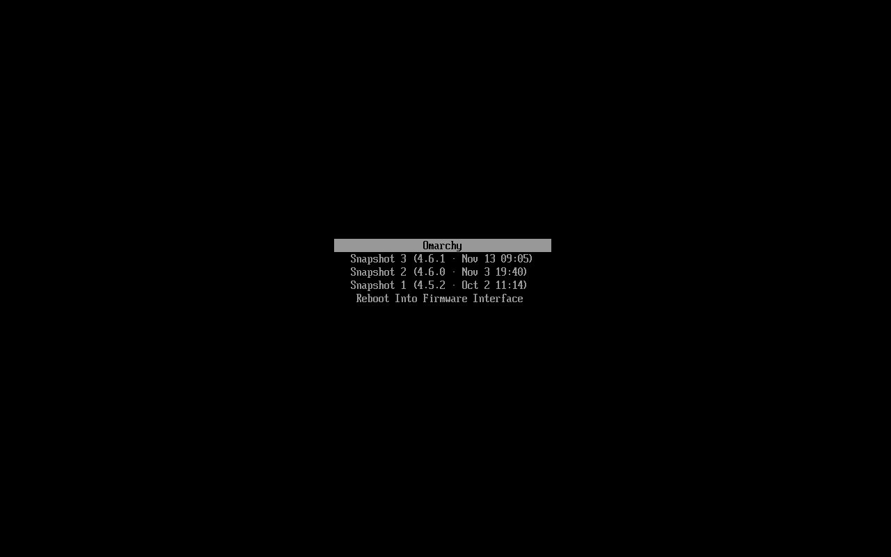
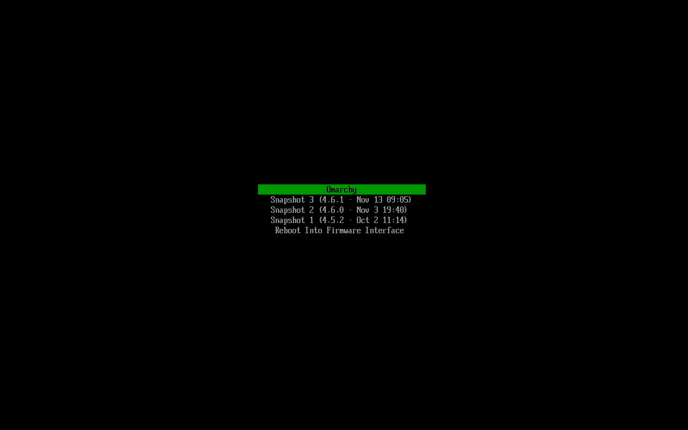

# systemd-boot snapshot boot under Secure Boot (QEMU prototype)

Microsoft only signs a shim whose second stage is GRUB or systemd-boot, so
Limine can't be the Secure Boot loader. limine-snapper-sync only writes
`limine.conf`. This prototype answers whether systemd-boot can do what
Limine does for snapper snapshots with Secure Boot enforcing, and what it
looks like.

It can. Each boot image (one kernel and initramfs build) becomes one signed
multi-profile UKI. The live system and every snapshot taken on that image
are profiles inside it, each carrying its own signed `subvol=` command line.

```
prototypes/systemd-boot-snapshots/run.sh [WORKDIR]    # about a minute, unprivileged
```

## What runs

`run.sh` builds everything in WORKDIR, then boots OVMF with Secure Boot:

- A test signing key, standing in for the per-machine key (MOK).
- Two real kernels: the running `linux-omarchy` and an older one from the
  pacman cache.
- Three boot images. Image A and image B are the same kernel with different
  initramfs builds, as after a mkinitcpio change.
- A btrfs root with `@` and read-only snapper snapshots 1–4 in snapper's
  layout (`info.xml` included).
- `omarchy-boot-sync` replays what would happen on a real machine:
  1. Import the old image and pin snapshot 1 to it.
  2. Import image A and pin snapshot 2.
  3. Import image B and pin snapshot 3.
  4. Sync. Snapshot 4 was never pinned, standing in for snapshots that
     predate the tool.
- An ESP holding:
  - systemd-boot signed with the test key;
  - the key as PK/KEK/db `.auth` files for systemd-boot's
    `secure-boot-enroll force`;
  - a tampered UKI and an unsigned UKI;
  - a type #1 entry that tries to pass its own command line to the signed
    live UKI.

The first boot starts in Setup Mode, where systemd-boot enrolls the key and
reboots. Every later boot has Secure Boot enforcing. A tiny busybox `init`
in each subvolume prints which subvolume, kernel and boot entry came up,
then powers off.

Results on an Omarchy host (systemd 262, kernels 7.2.14 and 7.2.8):

```
PASS sync made the live profile the default entry
PASS systemd-boot enrolled the key in Setup Mode
PASS live boots with Secure Boot on, @ writable
PASS live root is subvol @
PASS snapshot 3 (current image, profile 1) boots
PASS snapshot 3 is a profile of the live UKI
PASS read-only snapshot is overlaid writable
PASS snapshot 2 boots its pinned older image A
PASS snapshot 2 comes up
PASS snapshot 1 boots the old kernel 7.2.8-10-omarchy
PASS snapshot 4 (never pinned) is not offered
PASS injected command line is ignored
PASS injected command line never reaches the kernel
PASS tampered UKI is refused
PASS firmware reports the tampered UKI as Access denied
PASS unsigned UKI is refused
PASS firmware reports the unsigned UKI as Access denied
```

## Files

| | |
|---|---|
| `omarchy-boot-sync` | Prototype replacement for limine-snapper-sync: `import`, `pin`, `sync` |
| `lib/uki_build.py` | Standard-library UKI assembler (stand-in for `ukify build --join-profile`) |
| `lib/mkauth.py` | Writes signed PK/KEK/db `.auth` files (`bootctl --secure-boot-auto-enroll` needs root) |
| `guest/init`, `guest/mkinitcpio.conf` | Test guest; the initramfs reuses `btrfs-overlayfs` unchanged |
| `theme/recolor-sdboot.py` | Patches systemd-boot's two menu colors, for previews |
| `theme/screenshot.sh` | Screenshots the menu and the splash over QMP |

`ukify`, `sbsign`, `sbctl` and `virt-fw-vars` aren't installed on Omarchy.
The two `lib/` scripts replace them with nothing but Python's standard
library, openssl and `systemd-sbsign`, so the prototype runs on a stock
install. Production should call `ukify` from the `systemd-ukify` package.

## How the UKIs are laid out

```
EFI/Linux/omarchy-7.2.14-1-omarchy-8e4c5818b465.efi      image B: live + snapshot 3
  .osrel .cmdline .uname [.splash] .initrd .linux          shared base
  .profile ID=omarchy        .osrel PRETTY_NAME=Omarchy
  .profile ID=snapshot-3     .osrel PRETTY_NAME="Snapshot 3"  .cmdline …subvol=@/.snapshots/3/snapshot
           TITLE=4.6.1 · Nov 13 09:05
EFI/Linux/omarchy-7.2.14-1-omarchy-1dac20a28658.efi      image A: snapshot 2 only
EFI/Linux/omarchy-7.2.8-10-omarchy-2c90312c18eb.efi      old kernel: snapshot 1 only
```

- **One UKI per boot image, not per snapshot.** ESP use grows with the
  number of distinct kernel and initramfs builds still referenced by a
  snapshot. Each UKI here is about 34 MB (19 MB kernel, 14 MB test
  initramfs). Omarchy's real initramfs is larger, so measure before setting
  an ESP budget.
- **Snapshots are pinned to an image, not just a kernel version.**
  `omarchy-boot-sync pin` records the image that was current when the
  snapshot was taken. Snapshot 2 still boots image A after image B replaced
  it. Rolling back from a broken initramfs change has to use the old
  initramfs.
- **Every sync re-signs the live UKI.** Adding a snapshot changes a profile
  inside it. So the signing key must be usable by root whenever snapper runs
  (it stays on the encrypted root, never the ESP), and the UKI is written
  beside the old one and renamed over it.

## systemd-boot behaviors found along the way

None of these are obvious from the docs. The prototype depends on them:

- **Entry IDs:** a UKI's first profile is listed under the bare file name
  (`omarchy-…-8e4c.efi`). Later profiles are `<file>@<profile ID>`
  (`…efi@snapshot-3`), not `@<number>`. Both work as `loader.conf` `default`
  values (globs too), and so for one-shot "reboot into snapshot N".
- **Titles:** a profile is shown as `PRETTY_NAME (TITLE)`. Every profile
  after the first gets a suffix anyway: `(TITLE)`, else `(ID)`, else
  `(Profile #N)` (see `theme/screenshots/title-rules.png`). So every snapshot
  sets `PRETTY_NAME="Snapshot N"` and `TITLE="<description> · <date>"`, and
  reads the same whichever UKI it's in.
- **Sorting:** entries sort by `IMAGE_ID`, then newest `IMAGE_VERSION`
  first, across all UKIs. A per-profile `.osrel` with `IMAGE_VERSION=999999`
  for the live profile and the snapshot number for snapshots gives
  "Omarchy, then snapshots newest first".
- **Secure Boot enforcement:** a type #1 entry passing
  `rootflags=subvol=@/.snapshots/2/snapshot INJECTED=1` to the signed live
  UKI booted `@` with the UKI's own command line. The firmware refuses
  tampered and unsigned UKIs with `Access denied`.
- **Kernel modules:** `linux-omarchy` signs every module and doesn't force
  lockdown under Secure Boot, so the kernel's own modules load. Out-of-tree
  modules (NVIDIA, DKMS) still need a signing story.

## Tokyo Night

| Menu, stock | Menu, recolored | Splash |
|---|---|---|
|  |  |  |

What can be styled, and how far:

- **The menu can only approximate Tokyo Night.** systemd-boot has no theme
  or color settings. It draws through the UEFI text console, which offers 16
  fixed EGA colors (8 for backgrounds), and each firmware maps them to its
  own RGB values. So `#1a1b26`, `#7aa2f7` and `#9ece6a` can't be shown
  exactly.
- **Best option tried: light gray entries, black on green for the
  highlight** (entry `0x07`, highlight `0x20`), echoing Limine's `9ece6a`
  branding. Neon green text and blue text looked worse; see
  `menu-variants.png` (stock, green bar, green text, blue text).
  `theme/recolor-sdboot.py` patches the binary for previews only. Shipping it
  means a two-constant source patch to `COLOR_ENTRY` / `COLOR_HIGHLIGHT` in
  a systemd-boot built and signed in omarchy-pkgs. We sign our own build
  anyway, with our own SBAT line.
- **The menu stays hidden by default** (as today with Limine's 1-second
  timeout), so most people never see it.
- **The splash can be exact.** The UKI's `.splash` is a full-RGB BMP that
  systemd-stub draws after an entry is picked. It draws the image centered
  on black, though, so a `#1a1b26` background shows up as a box. The splash
  is therefore the Omarchy logo from the Plymouth theme on black. Plymouth
  then takes over with Tokyo Night `#1a1b26`, as today.

To reproduce the screenshots:

```
magick /usr/share/plymouth/themes/omarchy/logo.png -background black -flatten -type TrueColor BMP3:splash.bmp
SPLASH=$PWD/splash.bmp ./run.sh "$WORK"
theme/recolor-sdboot.py /usr/lib/systemd/boot/efi/systemd-bootx64.efi tokyo.efi 07 20
theme/screenshot.sh "$WORK" tokyo tokyo.efi 25
```

## Not covered yet

- **shim and MokManager.** This run puts the test key straight into the
  firmware's db. The production chain is Microsoft → Omarchy shim → MOK-signed
  systemd-boot and UKIs. systemd-boot uses shim's verification for the UKIs
  it loads, but that needs a shim binary to prove it. Downloading one was
  blocked in this session.
- **Real snapper wiring.**
  - A `/usr/lib/snapper/plugins/` hook calling `pin` + `sync` on
    `create-snapshot-post` and `sync` on `delete-snapshot-post`.
  - A mkinitcpio post hook calling `import`, with mkinitcpio writing a plain
    initramfs into the store instead of a UKI to the ESP.
- **The store's location.** It has to survive a rollback of `@`, so a
  separate subvolume (or `/.snapshots`, which already does), never the ESP.
- **Restore.** `omarchy-snapshot restore` swapping `@` for the booted
  snapshot, replacing `limine-snapper-restore`.
- **Kernel parameters.** `KERNEL_CMDLINE` additions in `/etc/default/limine`
  (hardware fixes, hibernation, Plymouth) moving to `/etc/cmdline.d/`.
- **Migrating existing Limine installs.**
